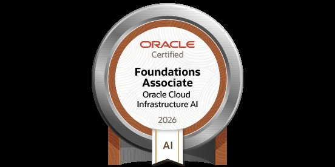

# Hi, I'm Danishiyan

I'm studying for a **BSc (Hons) in Information Technology Specialising in Artificial Intelligence** at the Sri Lanka Institute of Information Technology (SLIIT).
I'm working towards an AI/ML or Cloud AI engineering internship.

## Now
Finishing v1 of **dengue-early-warning**, now [live on Render](https://dengue-early-warning-lwgf.onrender.com/docs). Next: adding weather data (v2) and deploying to Azure.

## Projects
| Project | What it does | Tech |
|---|---|---|
| [dengue-early-warning](https://github.com/Danishiyan/dengue-early-warning) · [**Live demo**](https://dengue-early-warning-lwgf.onrender.com/docs) | Forecasts next week's dengue cases for 26 Sri Lankan health areas. Gradient boosting with 5.6% lower error than the best baseline (better in 23 of 26 areas), served as a FastAPI API in Docker, deployed on Render with CI and tests. | Python, scikit-learn, FastAPI, Docker, MLflow, GitHub Actions, Render |
| [letter-recognition-ml](https://github.com/Danishiyan/letter-recognition-ml) | Recognises the 26 capital letters from 16 shape features. Compared 7 models; best was an SVM with 97.3% test accuracy. | Python, scikit-learn, pandas |
| [Ceylon Trails](https://github.com/Danishiyan/ceylon-trails-safari-management) (team of 6) | Safari trip management system. I built the package catalogue and booking backend, using the Observer pattern for cancellations. | Java, Spring Boot, SQL Server, React |
| [OCEANWAVE](https://github.com/Danishiyan/oceanwave-tourism-platform) (team) | Tourism package customisation platform. I built the package customisation module: CRUD, pricing and budget logic, and a REST API, using the repository pattern. | Java, Spring Boot, JSP |
| [Eco Bin](https://github.com/Danishiyan/eco-bin-smart-waste-segregation) (team of 6) | Arduino bin that sorts metal, wet and dry waste with sensors, a stepper motor and a servo. I co-wrote the sensor and sorting code. | Arduino, C++ |

## Certifications

- **Oracle Cloud Infrastructure Certified AI Foundations Associate**, Oracle, Nov 2026 ([verify](https://catalog-education.oracle.com/pls/certview/sharebadge?id=468F8DE7A1234359E05552E84DFB21A9AFF3ED5EBB6DB5D6CD6830CDB309239B))

## Tools
Python · scikit-learn · pandas · NumPy · Matplotlib · FastAPI · Docker · MLflow · pytest · GitHub Actions · Render · Java · Spring Boot · SQL · Git · Oracle Cloud (OCI)

## Contact

📧 **Email:** jeyakumardanishiyan2004@gmail.com

💼 **LinkedIn:** [linkedin.com/in/danishiyan-gj](https://www.linkedin.com/in/danishiyan-gj)

My commits in team projects (OCEANWAVE, Ceylon Trails) appear under my university coursework account, [IT25101436](https://github.com/IT25101436).
